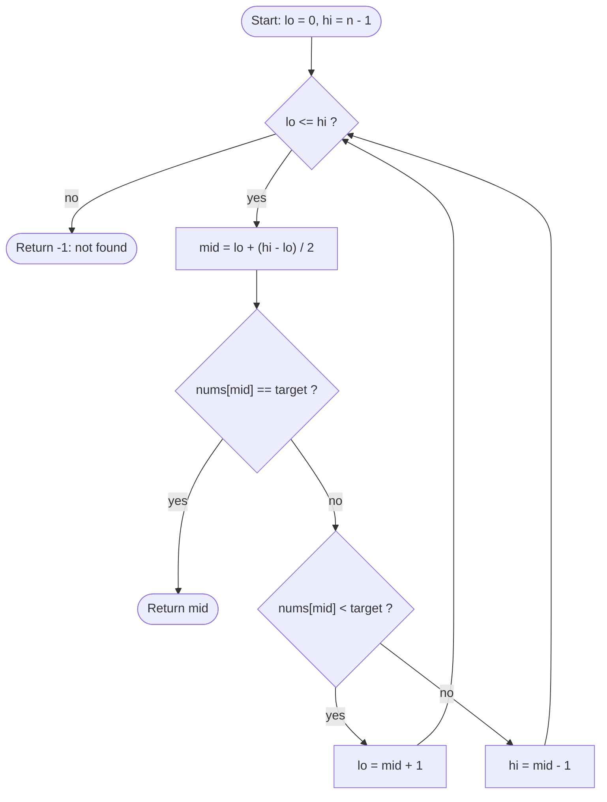
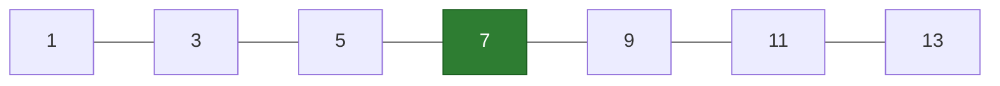
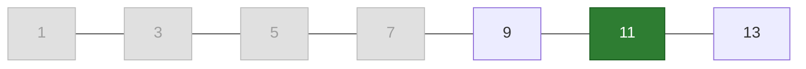
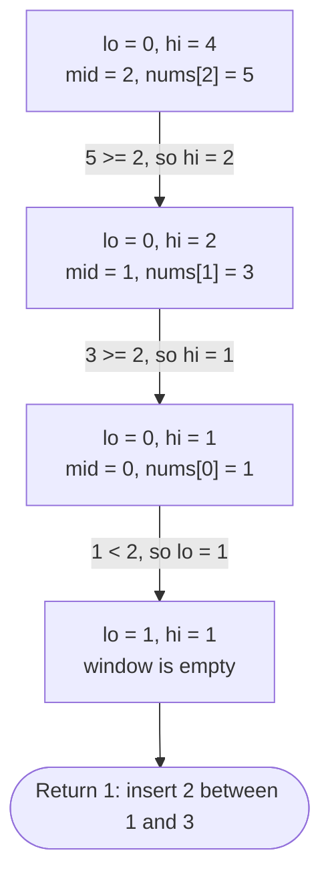

# Binary Search

## Quick Description (QD)

**Binary search** finds a value in a **sorted** collection by repeatedly cutting the search space in half. Compare the middle element with the target. If the middle is too small, the target can only be in the right half. If it is too big, the target can only be in the left half. Throw away the half that cannot contain it and repeat.

Each step halves the window, so searching `n` elements takes at most about `log2(n)` steps: 20 steps for a million elements, and about 30 for a billion. A linear scan would take up to `n`.

Binary search only works when the data is sorted, or more generally when the answer flips from "no" to "yes" at exactly one point.



### Walkthrough

Search for `11` in `[1, 3, 5, 7, 9, 11, 13]`. The green cell is the middle element being compared, and grey cells have been ruled out.

**Step 1:** `lo = 0`, `hi = 6`, `mid = 3`. Since `nums[3] = 7` is less than `11`, the target can only be on the right, so `lo = 4`.



**Step 2:** `lo = 4`, `hi = 6`, `mid = 5`. Since `nums[5] = 11` equals the target, return `5`.



Two steps were enough, where a linear scan would have needed six comparisons.

## Installation

_Nothing here yet._

## Useful Tips/Commands (UToC)

- **Pick an invariant and keep it.** Decide what the window `lo..hi` means (inclusive or half-open) and make every update respect it. Most binary search bugs come from mixing the two styles.
- **Write `mid` as `lo + (hi-lo)/2`.** It is equal to `(lo+hi)/2` but cannot overflow. Go's `int` is 64 bits, but the habit pays off in languages with 32-bit integers. This was a real bug in the JDK's binary search for years.
- **Always shrink the window.** `lo = mid` or `hi = mid` in a closed-window search can loop forever. Use `mid + 1` and `mid - 1`, or the half-open form shown below.
- **The input must be sorted.** On unsorted data, binary search returns wrong answers without any error.
- **Test the edges.** Check the empty slice, one element, a target smaller than everything, a target larger than everything, and duplicates.
- **Prefer the standard library when you can.** In Go, `slices.BinarySearch` returns the index and whether it was found, and `sort.SearchInts` returns the insertion index:

```go
i, found := slices.BinarySearch([]int{1, 3, 5, 6}, 2) // 1, false
j := sort.SearchInts([]int{1, 3, 5, 6}, 2)             // 1
```

- **It works on answers, not just arrays.** If you can test "is `x` big enough?" and the result flips once from false to true, you can binary search over `x` itself (for example, the smallest capacity that works).

## Examples (e.g.,)

### Classic Binary Search in Go

```go
// binarySearch returns the index of target in the sorted slice nums, or -1.
func binarySearch(nums []int, target int) int {
	lo, hi := 0, len(nums)-1 // the search window is nums[lo..hi], both ends included
	for lo <= hi {
		mid := lo + (hi-lo)/2 // same as (lo+hi)/2 but cannot overflow
		switch {
		case nums[mid] == target:
			return mid
		case nums[mid] < target:
			lo = mid + 1 // target can only be on the right
		default:
			hi = mid - 1 // target can only be on the left
		}
	}
	return -1
}
```

Time is O(log n) and space is O(1).

### Problem: Search Insert Position

Given a sorted slice of distinct integers and a target, return the index of the target. If it is not there, return the index where it would be inserted to keep the slice sorted. The solution must run in O(log n). This is [LeetCode 35](https://leetcode.com/problems/search-insert-position/).

```text
nums = [1, 3, 5, 6], target = 5  ->  2
nums = [1, 3, 5, 6], target = 2  ->  1
nums = [1, 3, 5, 6], target = 7  ->  4
nums = [1, 3, 5, 6], target = 0  ->  0
```

**Idea.** The answer is the index of the first element that is greater than or equal to the target. This is called the **lower bound**. It also covers the "not found" case: if every element is smaller, the answer is `len(nums)`, which is the end of the slice.

For this version, use a **half-open window** `[lo, hi)`, where `hi` is one past the last candidate. The invariant is: *the answer is always in `lo..hi`*.

- If `nums[mid] < target`, then `mid` and everything before it is too small, so `lo = mid + 1`.
- Otherwise `mid` could be the answer, so keep it in the window with `hi = mid`.

When `lo == hi`, the window is empty and that index is the answer.

**Solution.**

```go
// searchInsert returns the index of target in the sorted slice nums, or the
// index where it would be inserted to keep nums sorted.
func searchInsert(nums []int, target int) int {
	lo, hi := 0, len(nums) // the search window is nums[lo..hi), hi is excluded
	for lo < hi {
		mid := lo + (hi-lo)/2
		if nums[mid] < target {
			lo = mid + 1 // everything up to mid is too small
		} else {
			hi = mid // mid could be the answer, so keep it in the window
		}
	}
	return lo
}
```

**Trace** for `nums = [1, 3, 5, 6]` and `target = 2`:



**Complexity.** Time is O(log n), because the window halves on every iteration. Space is O(1).

**Edge cases.** For an empty slice, the loop never runs and the answer is `0`. For a target smaller than everything, `hi` keeps moving left until it reaches `0`. For a target larger than everything, `lo` moves right until it reaches `len(nums)`.

**Try it.** Find the first and last position of a target in a sorted slice with duplicates ([LeetCode 34](https://leetcode.com/problems/find-first-and-last-position-of-element-in-sorted-array/)). It is two lower-bound searches.

## References

- [Binary search algorithm (Wikipedia)](https://en.wikipedia.org/wiki/Binary_search_algorithm)
- [slices.BinarySearch, Go standard library](https://pkg.go.dev/slices#BinarySearch)
- [sort.SearchInts, Go standard library](https://pkg.go.dev/sort#SearchInts)
- [Extra, Extra - Read All About It: Nearly All Binary Searches and Mergesorts are Broken (Google Research)](https://research.google/blog/extra-extra-read-all-about-it-nearly-all-binary-searches-and-mergesorts-are-broken/)
- [Search Insert Position (LeetCode 35)](https://leetcode.com/problems/search-insert-position/)
- [Find First and Last Position of Element in Sorted Array (LeetCode 34)](https://leetcode.com/problems/find-first-and-last-position-of-element-in-sorted-array/)
