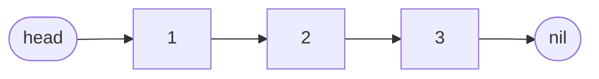
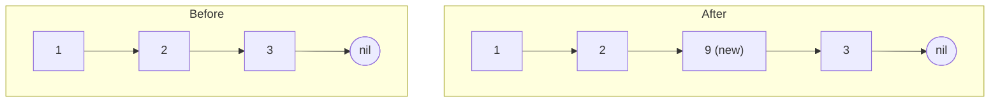
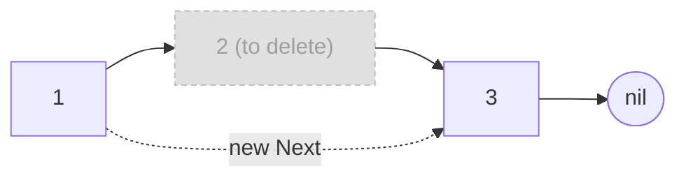
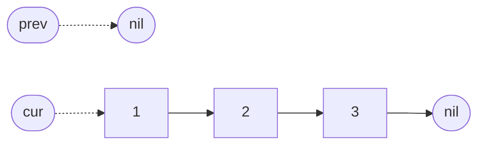
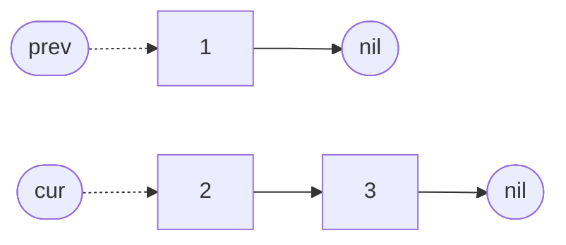
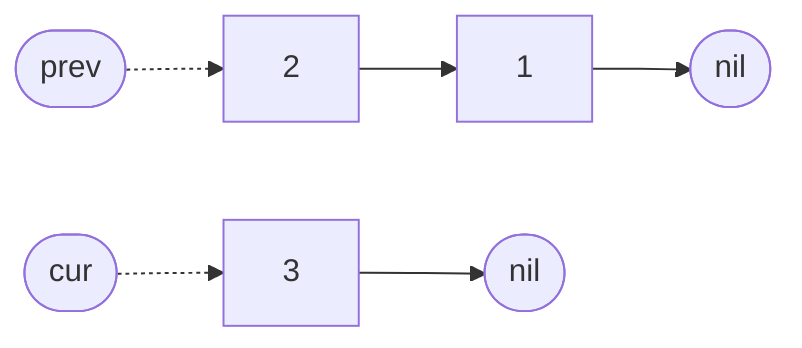
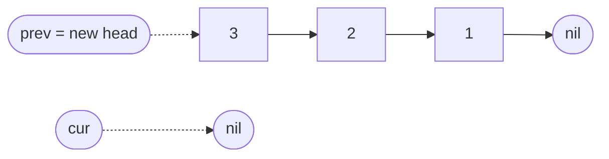

# Linked List

## Quick Description (QD)

A **linked list** stores a sequence of values as separate **nodes**. Each node holds a value and a pointer to the next node. The list itself only remembers the first node, called the **head**. The last node points to `nil`, which marks the end.



An array keeps its elements side by side in memory, so `a[i]` is a single address calculation. A linked list's nodes can live anywhere in memory, so reaching the i-th element means following `i` pointers. In exchange, adding or removing a node only changes a pointer or two and never shifts other elements.

| | Array | Linked list |
| --- | --- | --- |
| Access by index | O(1) | O(n) |
| Insert or delete at the front | O(n) | O(1) |
| Insert or delete after a node you already hold | O(n) | O(1) |
| Search by value | O(n) | O(n) |
| Memory | Compact | Extra pointer per node, poor cache locality |

This page covers the **singly linked list**, where each node only knows its next node. A doubly linked list adds a `prev` pointer, so you can walk backwards and delete a node in O(1) without a pointer to its predecessor.

### Insert After a Node

To insert `9` after `2`, create the new node and rewire two pointers. Do it in this order: first point the new node at what `2` currently points to, then point `2` at the new node. Doing it the other way round loses the rest of the list.



### Delete a Node

To delete `2`, make its predecessor skip over it: set `1.Next` to what `2` points to. Node `2` is now unreachable and the garbage collector frees it. Deleting the head is a special case, because there is no predecessor: move `head` forward instead.



## Installation

_Nothing here yet._

## Useful Tips/Commands (UToC)

- Always check for `nil` before you follow a `Next` pointer. Most linked list bugs are nil dereferences.
- Handle the empty list, the one-element list, and operations on the head as separate cases. They are where bugs hide.
- When you change pointers, draw the before and after states on paper first, as in the diagrams above.
- Two pointers move through the list at once in many problems. A **fast and slow** pair (fast moves two steps, slow moves one) finds the middle of a list and detects cycles.
- A **dummy node** placed before the head removes the special case for the head, because every real node then has a predecessor.
- In Go, you rarely need your own list. The standard library has a doubly linked list in [`container/list`](https://pkg.go.dev/container/list), and a slice is usually faster in practice.

## Examples (e.g.,)

### A Linked List in Go

```go
package main

import (
	"fmt"
	"strings"
)

// Node is a single element of a singly linked list.
type Node struct {
	Val  int
	Next *Node
}

// List keeps a pointer to the first node.
type List struct {
	Head *Node
}

// PushFront inserts a value at the head in O(1).
func (l *List) PushFront(v int) {
	l.Head = &Node{Val: v, Next: l.Head}
}

// PushBack inserts a value at the tail in O(n), because we must walk to the end.
func (l *List) PushBack(v int) {
	n := &Node{Val: v}
	if l.Head == nil {
		l.Head = n
		return
	}
	cur := l.Head
	for cur.Next != nil {
		cur = cur.Next
	}
	cur.Next = n
}

// InsertAfter inserts v after the first node that holds target.
// It reports whether target was found.
func (l *List) InsertAfter(target, v int) bool {
	for cur := l.Head; cur != nil; cur = cur.Next {
		if cur.Val == target {
			cur.Next = &Node{Val: v, Next: cur.Next}
			return true
		}
	}
	return false
}

// Delete removes the first node that holds v. It reports whether v was found.
func (l *List) Delete(v int) bool {
	if l.Head == nil {
		return false
	}
	if l.Head.Val == v {
		l.Head = l.Head.Next
		return true
	}
	for cur := l.Head; cur.Next != nil; cur = cur.Next {
		if cur.Next.Val == v {
			cur.Next = cur.Next.Next
			return true
		}
	}
	return false
}

// Find returns the first node that holds v, or nil.
func (l *List) Find(v int) *Node {
	for cur := l.Head; cur != nil; cur = cur.Next {
		if cur.Val == v {
			return cur
		}
	}
	return nil
}

func (l *List) String() string {
	var parts []string
	for cur := l.Head; cur != nil; cur = cur.Next {
		parts = append(parts, fmt.Sprint(cur.Val))
	}
	return strings.Join(append(parts, "nil"), " -> ")
}

func main() {
	l := &List{}
	l.PushFront(2)
	l.PushFront(1)
	l.PushBack(4)
	fmt.Println(l) // 1 -> 2 -> 4 -> nil
	l.InsertAfter(2, 3)
	fmt.Println(l) // 1 -> 2 -> 3 -> 4 -> nil
	l.Delete(3)
	fmt.Println(l) // 1 -> 2 -> 4 -> nil
}
```

### Problem: Reverse a Linked List

Given the head of a singly linked list, reverse the list and return the new head. This is [LeetCode 206](https://leetcode.com/problems/reverse-linked-list/).

```text
Input:  1 -> 2 -> 3 -> nil
Output: 3 -> 2 -> 1 -> nil
```

**Idea.** Walk the list once and flip each `Next` pointer to point backwards. To do that safely, keep two pointers: `prev`, the part already reversed, and `cur`, the node you are about to flip. Before you overwrite `cur.Next`, save it in `next`, or you lose the rest of the list.

**Steps.** Repeat while `cur` is not `nil`:

1. `next = cur.Next`, to remember the rest of the list.
2. `cur.Next = prev`, to point the current node backwards.
3. `prev = cur`, to move `prev` forward.
4. `cur = next`, to move `cur` forward.

The diagrams show the state at the start and after each iteration. Dashed arrows are the `prev` and `cur` pointers.

**Start.**



**After iteration 1.** Node 1 now points to `nil`.



**After iteration 2.** Node 2 now points to node 1.



**After iteration 3.** `cur` is `nil`, so the loop stops and `prev` is the new head.



**Solution.**

```go
// reverseList reverses a singly linked list in place and returns the new head.
func reverseList(head *Node) *Node {
	var prev *Node
	cur := head
	for cur != nil {
		next := cur.Next // 1. remember the rest of the list
		cur.Next = prev  // 2. point the current node backwards
		prev = cur       // 3. move prev forward
		cur = next       // 4. move cur forward
	}
	return prev // prev is the old tail, the new head
}
```

**Complexity.** Time is O(n), because each node is visited once. Space is O(1), because the list is reversed in place with three pointers.

**Edge cases.** An empty list returns `nil`, since the loop never runs and `prev` is still `nil`. A one-node list returns that same node, whose `Next` is set to `nil`.

**Try it.** Reverse the same list recursively, then reverse only the part between positions `left` and `right` ([LeetCode 92](https://leetcode.com/problems/reverse-linked-list-ii/)).

## References

- [Linked list (Wikipedia)](https://en.wikipedia.org/wiki/Linked_list)
- [container/list, Go standard library](https://pkg.go.dev/container/list)
- [Reverse Linked List (LeetCode 206)](https://leetcode.com/problems/reverse-linked-list/)
- [Reverse Linked List II (LeetCode 92)](https://leetcode.com/problems/reverse-linked-list-ii/)
