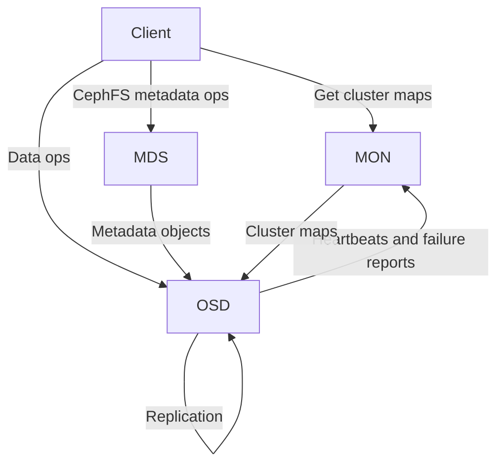

# Ceph Storage Cluster

## Quick Description (QD)

A Ceph Storage Cluster is a distributed storage system that provides high performance, reliability, and scalability. It aggregates storage resources from multiple nodes and presents them as a unified storage pool.

### Key Components

- **OSD (Object Storage Daemon):** Handles data storage, replication, recovery, and rebalancing.
- **MON (Monitor):** Maintains the cluster maps and handles authentication.
- **MGR (Manager):** Tracks runtime metrics and hosts modules such as the dashboard.
- **MDS (Metadata Server):** Manages metadata for CephFS (Ceph File System). It stores that metadata as objects in RADOS, so it is optional unless you use CephFS.

See [Components](01_components.md) for more detail.

### Features

- **Scalability:** Nodes and OSDs can be added or removed while the cluster is running; data is rebalanced automatically.
- **Fault tolerance:** Data is replicated (or erasure coded) across failure domains to prevent data loss.
- **Self-healing:** OSDs report failures and the cluster re-replicates the affected data.

### Basic Architecture

Clients fetch the cluster maps from a MON, then talk to OSDs directly for data. Only CephFS clients also talk to an MDS for metadata, and the MDS itself reads and writes its metadata as objects on the OSDs.

### Use Cases

- Cloud storage backends
- High-performance computing
- Enterprise data storage

## Installation

_Nothing here yet._

## Useful Tips/Commands (UToC)

_Nothing here yet._

## Examples (e.g.,)

_Nothing here yet._

## References

- [Ceph Documentation: The Parts of a Ceph Cluster](https://docs.ceph.com/en/latest/start/ceph-cluster-components/)
- [Ceph Documentation: Architecture](https://docs.ceph.com/en/latest/architecture/)
- [Ceph Documentation: CephFS](https://docs.ceph.com/en/latest/cephfs/)
